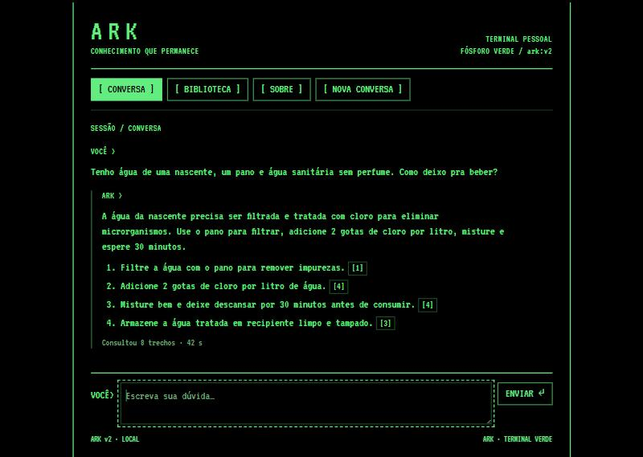

# ARK — Autonomous Resilience & Knowledge

> **Aviso de segurança.** O ARK é experimental. Na última validação com dúvidas reais, 3 de 20 respostas foram perigosas: a fonte dizia para não usar a água e o modelo orientou tratar e usar. A versão seguinte corrigiu uma delas; as outras duas continuam abertas. O ARK não substitui a Defesa Civil, o serviço de saúde nem a orientação oficial. Sempre confira a fonte citada antes de agir. Detalhes em [SEGURANCA.md](SEGURANCA.md).

O ARK é uma biblioteca de sobrevivência que roda no seu computador, sem internet, e responde em português com citação da fonte. O cenário é o colapso da infraestrutura urbana: sem água encanada, sem luz, sem gás, e você precisando se virar em casa. O piloto cobre **água e alimentação**.

Por baixo, é um RAG local: a pergunta vira de 2 a 4 buscas, a busca encontra trechos de documentos oficiais (Ministério da Saúde, Anvisa, CDC, FDA, EPA e outros) e um modelo pequeno escreve a resposta a partir deles, citando a página.

## Por que existe

Todo produto tem um usuário-alvo. O nosso nasceu em apartamento, resolve a vida por app e não dura três dias de apocalipse. Quando a rede cai, o app cai junto. O ARK é a arca: o conhecimento oficial guardado no seu disco, consultável em linguagem normal.

Por isso o custo é premissa, não detalhe. Toda mudança é medida também em disco, memória e tempo de resposta, porque a meta é rodar em máquina cada vez mais fraca.

## Onde está hoje

| Medida | Resultado |
| --- | --- |
| Cobertura das necessidades nas dúvidas reais | 61% |
| Respostas perigosas na validação | 3 de 20 (1 corrigida depois) |
| Tempo por resposta | 25 a 42 s |
| Pico de memória de vídeo | 7,8 GB (RTX 4060, 8 GB) |
| Funciona sem internet | Sim, testado com a rede desligada |

Esses números foram medidos na nossa configuração (Qwen3 8B, bge-m3, reranker, RTX 4060) e no nosso acervo de 24 documentos, que não é publicado. Com outro acervo ou outro hardware, os números mudam.

A jornada inteira, inclusive a v1 que foi abandonada, está em [HISTORIA.md](HISTORIA.md).

## Como é



## Como funciona

```
pergunta → Qwen3 8B decompõe em 2-4 buscas → bge-m3 (embeddings) → reranker → 8 trechos
        → Qwen3 8B escreve com as fontes → checagem de números por código → resposta citada
```

## Como rodar

Requisitos da prova de conceito: Windows ou Linux, GPU com 8 GB de VRAM, Python 3.12, [Ollama](https://ollama.com), [Poppler](https://poppler.freedesktop.org) (`pdftotext`) e uns 12 GB de disco para modelos e dependências (estimativa).

Com internet, uma vez:

```
pip install -r requirements.txt
ollama pull qwen3:8b
ollama pull bge-m3
python -c "from sentence_transformers import CrossEncoder; CrossEncoder('BAAI/bge-reranker-v2-m3')"
python v2/corpus/acervo_proprio.py --library ./minha-biblioteca
```

O último comando lê todos os `.pdf` e `.txt` da sua pasta (veja [O acervo](#o-acervo)). Depois disso, sem internet:

```
python v2/app/servidor.py               # abre em http://127.0.0.1:8090
```

Na primeira pergunta, o app calcula os vetores do acervo e guarda em cache; as seguintes são mais rápidas.

## O acervo

O ARK é o motor; o acervo é seu. O repositório não traz os documentos, porque eles pertencem às instituições que os publicaram. O [GUIA-DE-FONTES.md](GUIA-DE-FONTES.md) diz como escolher fontes confiáveis, com um bloco de instruções pronto para um modelo buscar por você.

Para começar mais rápido, [acervo/fontes.json](acervo/fontes.json) lista as 24 fontes que usamos, com licença, o script `acervo/baixar_acervo.py` tenta baixá-las e `acervo/recortes/` traz 13 recortes traduzidos de fontes de domínio público ou CC BY. Isso aproxima o nosso acervo, mas não o reproduz: algumas fontes mudaram ou bloqueiam download, e a extração de texto varia. Com o script, monte o corpus com `python v2/corpus/build_passages.py --library ./biblioteca` no lugar do `acervo_proprio.py`.

## Como medir

Os casos de avaliação ficam em `v2/eval/`. Eles citam trechos do nosso acervo: com o seu, use as perguntas e refaça os trechos aceitos (veja o [guia](GUIA-DE-FONTES.md#como-medir-com-o-seu-acervo)). Toda mudança na resposta é medida contra eles:

```
python v2/eval/retrieval_eval.py        # a busca acha os trechos certos?
python v2/eval/answer_eval.py           # a resposta cobre o que precisa, sem erro perigoso?
```

## Contribuir

Leia [CONTRIBUTING.md](CONTRIBUTING.md) e o [código de conduta](CODE_OF_CONDUCT.md). A regra de ouro: corrigimos categorias de erro, nunca frases. Uma boa porta de entrada são as issues marcadas como `good first issue`. Viu uma resposta perigosa? Abra uma issue com o modelo "Resposta perigosa".

## Licenças

- Código: [MIT](LICENSE).
- Documentação e casos de avaliação: [CC BY 4.0](https://creativecommons.org/licenses/by/4.0/deed.pt_BR).
- Acervo: cada documento segue a licença da sua instituição, registrada em `acervo/fontes.json`.
- Fonte VT323 do app (`v2/app/ark-vt.woff2`): SIL Open Font License 1.1, The VT323 Project Authors.
- Modelos e ferramentas usados, não distribuídos aqui: Qwen3 (Apache-2.0), bge-m3 (MIT), bge-reranker-v2-m3 (Apache-2.0), Ollama (MIT).

## In English

ARK is an offline survival library that runs on your own computer and answers in Brazilian Portuguese, citing official sources (Brazilian Ministry of Health, Anvisa, CDC, FDA, EPA). It targets everyday survival when urban infrastructure fails: no running water, power or gas. Under the hood it is a local RAG pipeline (Qwen3 8B, bge-m3, a reranker) built to fit in 8 GB of VRAM. It is experimental: in the latest validation, 3 of 20 answers were unsafe. Contributions are welcome, especially new evaluation cases, unsafe-answer reports and ports to weaker hardware. See [CONTRIBUTING.md](CONTRIBUTING.md); issues in English are fine.
